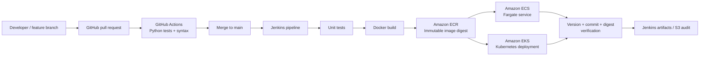

<div align="center">

# One Application. Two Orchestrators. One Verified Release.

### End-to-end CI/CD on AWS with GitHub Actions, Jenkins, Docker, ECR, ECS Fargate & Kubernetes (EKS)

**A working, tested container delivery pipeline — from Git commit to identical, healthy application releases on ECS and EKS.**

[](https://github.com/Fadil1212/student-starter/actions/workflows/ci.yml)


[Architecture](#architecture) · [Demo & evidence](#deployment-evidence) · [Pipeline](#how-the-cicd-pipeline-works) · [Run locally](#run-locally) · [Recovery experiments](#resilience-and-scaling-experiment) · [Technical report](#technical-report)

</div>

---

## The project in 30 seconds

I built and validated an **end-to-end container delivery workflow** that tests a Python API, builds an immutable Docker image, pushes that image to **Amazon ECR**, and deploys **the exact same image digest** to **Amazon ECS on Fargate** and **Amazon EKS on managed EC2 nodes**.

The project goes beyond a successful deployment: I added a version 2.0 feature in a separate branch, opened [Pull Request #1](https://github.com/Fadil1212/student-starter/pull/1), passed CI, merged it into `main`, and used Jenkins to ship the new version to both platforms. Finally, I ran **controlled failure, rollback and scaling experiments** to test recovery instead of just assuming the deployments would stay healthy.

> **Status:** Completed lab demonstration on November 13, 2026. Cloud resources were intentionally deleted after evidence collection to avoid ongoing charges. Localhost preview URLs shown in the report are **not public live demos**.

## Verified outcomes

| Evidence | Observed result |
| --- | --- |
| Automated application tests | **5 / 5 passing** |
| GitHub Actions PR checks | **2 successful checks** |
| Enhanced release | **v2.0.0** on ECS and EKS |
| Build provenance | Same Git commit and **same immutable container image digest** on both runtimes |
| Application health | **HTTP 200** on `/healthz` for both deployments |
| EKS recovery | Intentional unhealthy rollout → explicit `kubectl rollout undo` → successful recovery |
| ECS recovery | Intentional unhealthy tasks → ECS circuit breaker restored previous working deployment |
| Scaling test | **2 ECS running tasks** and **2 EKS ready replicas**, then returned to 1 |
| Final extension verification | **PASS** |
| Evidence retention | Jenkins JSON artifacts plus private SSE-S3 audit object during lab |
| Cleanup | ECS service deleted; CloudFormation stack `DELETE_COMPLETE`; GitHub deploy key removed |

These are **observed workshop results**, not production uptime, load-test or cost-benchmark claims.

## Architecture



The **image digest** is the link between source code and both running environments. The build artifact recorded:

- **Merged Git commit:** `4d6c5f387c0f468d3104218ecd09d866ca63ddf2`
- **Image digest:** `sha256:47415236fabbd4df068d59d4427eaac05218bbeff72ce479b2bfe0f81c8b897c`
- **Release:** `2.0.0` on ECS and EKS

## How the CI/CD pipeline works

1. **Develop & review:** implement `/api/compare` in `enhancement/platform-comparison` and open a PR.
2. **Continuous integration:** GitHub Actions runs the Python unit tests and validates syntax. The merge only followed successful checks.
3. **Build once:** Jenkins checks out `main`, reruns tests, and builds the Docker image with a source revision.
4. **Publish immutably:** push to an ECR repository configured with immutable tags and image scanning on push.
5. **Deploy twice:** deploy the image by digest to an ECS Fargate service and a Kubernetes Deployment in EKS.
6. **Prove identity:** compare the reported release, source commit and image digest across both deployments. Archive machine-readable verification JSON.
7. **Test resilience:** optionally run `CLOUD_EXTENSION` for controlled rollout failure, rollback, scale-out and restoration.

The stages are implemented in the [Jenkinsfile](Jenkinsfile), [GitHub workflow](.github/workflows/ci.yml), [deployment script](scripts/lab.py), and [recovery extension](scripts/cloud_extension.py).

## Deployment evidence

**The workshop deployment has been decommissioned.** The images and report below record actual results from November 13, 2026.

| Evidence | What it demonstrates |
| --- | --- |
| [Application on ECS](docs/screenshots/ecs-v2.jpg) | Healthy v2.0.0 served on ECS |
| [Application on EKS](docs/screenshots/eks-v2.jpg) | Healthy v2.0.0 served on EKS |
| [ECS vs EKS comparison](docs/screenshots/comparison.jpg) | Version 2 comparison feature |
| [Five passing tests](docs/screenshots/tests.jpg) | Unit test suite including comparison endpoint |
| [GitHub PR and checks](docs/screenshots/pr-merged.jpg) | Reviewed and merged feature delivery |
| [Recovery/scaling evidence](docs/screenshots/extension.jpg) | Failed ECS task health checks, 2+2 replicas, final PASS |
| [Infrastructure cleanup](docs/screenshots/cleanup.jpg) | CloudFormation `DELETE_COMPLETE` |

Screenshots and the sanitized report are kept under [`docs/`](docs/README.md). The full workshop evidence includes the Jenkins verification artifact and Cloud Computing extension report.

## Resilience and scaling experiment

This was an **intentional failure test**. The Python application can return HTTP 503 when `FORCE_UNHEALTHY=true`.

| Scenario | ECS (Fargate) | EKS (Kubernetes on EC2) |
| --- | --- | --- |
| Unhealthy release | ECS task fails container health check | New Kubernetes pods fail readiness |
| Recovery path | Deployment circuit breaker rolled back | Script explicitly ran `kubectl rollout undo` |
| Scaling mechanism | Service desired task count | Deployment replica count |
| Demonstrated scale | 2 running tasks | 2 ready replicas |
| After experiment | Healthy v2.0.0 restored | Healthy v2.0.0 restored |

**Engineering takeaway:** rollback behavior is a property of the deployment configuration and automation, not something to assume from an orchestrator's name. The lab measured state transitions, **not** comparative latency or throughput.

## The application

A lightweight, dependency-free Python HTTP server serves an HTML dashboard and exposes:

| Route | Purpose |
| --- | --- |
| `/` | Release dashboard |
| `/healthz` | Health probe (200 normally; 503 when `FORCE_UNHEALTHY=true`) |
| `/api/info` | Release version, commit, and runtime platform |
| `/version` | Version metadata |
| `/api/compare` | Four ECS/EKS comparison categories |

### Run locally

Requires **Python 3**; no third-party packages for the app or unit tests.

```bash
git clone https://github.com/Fadil1212/student-starter.git
cd student-starter
python3 -m unittest discover -s tests -v
python3 app/server.py
```

Then open [http://localhost:8080](http://localhost:8080) and try:

```bash
curl http://localhost:8080/healthz
curl http://localhost:8080/api/info
curl http://localhost:8080/api/compare
```

To run the container:

```bash
docker build -t ecs-eks-cicd-demo .
docker run --rm -p 8080:8080 ecs-eks-cicd-demo
```

AWS deployment requires an authorized AWS account, configured AWS CLI, existing roles, and the workshop-specific infrastructure. **Do not deploy solely to reproduce screenshots**: the managed EKS control plane, worker nodes, Jenkins host and other services can incur costs.

## Project structure

```text
app/                   Python HTTP server, release metadata and dashboard
tests/                 Unit tests (including failure and source identity cases)
.github/workflows/     GitHub Actions CI
Jenkinsfile            Multistage delivery pipeline
Dockerfile             Non-root application image and health check
infra/                 CloudFormation and Jenkins provisioning scripts
scripts/lab.py         Image build, ECS/EKS deployment and verification
scripts/cloud_extension.py  Failure recovery, rollback and scaling
docs/                  Screenshots, case study and report
```

## Technical report

The documented case study includes the implementation flow, observed rollback behavior, identity verification, comparisons of ECS and EKS, and completed infrastructure cleanup.

- [Engineering case study](docs/CASE_STUDY.md)
- [Evidence gallery](docs/README.md)
- [Workshop report (Word)](docs/ECS_EKS_CICD_Project_Report.docx)

## Key technologies and skills

**CI/CD:** Jenkins pipelines, GitHub Actions, Git branching and pull requests, artifact retention  
**Containers:** Docker, non-root containers, health checks, immutable ECR image digests  
**Cloud:** AWS ECS Fargate, EKS, EC2, CloudFormation, S3, IAM, SSM  
**Kubernetes:** Deployments, Services, readiness probes, rollout undo, replica scaling  
**Engineering:** API development, Python unit testing, release traceability, failure injection, rollback and secure teardown

---

<sub>Implemented and validated by **Fadil Mohammed Surur** as a Cloud Computing workshop project. Source code and evidence are preserved; cloud resources are intentionally no longer running.</sub>
