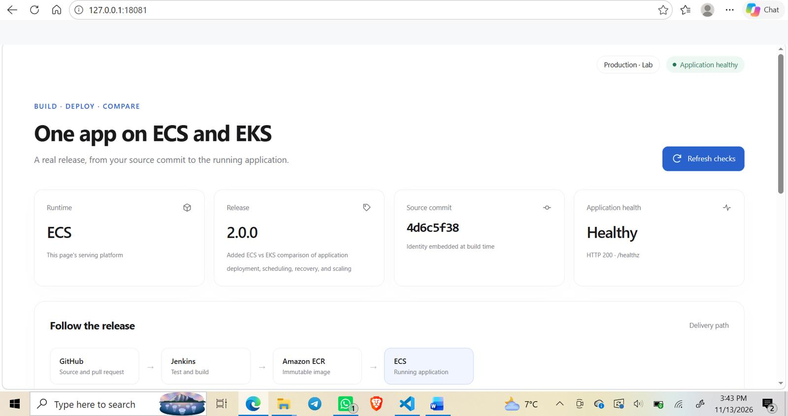
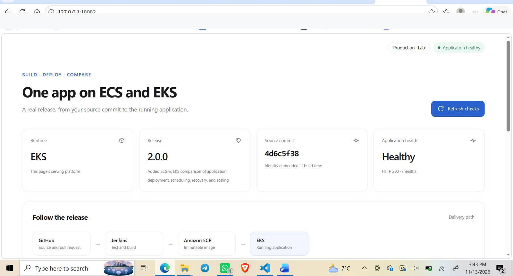
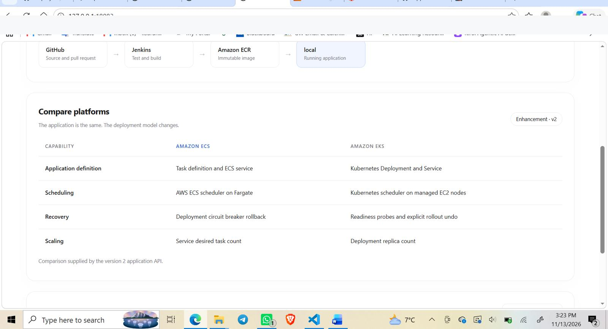
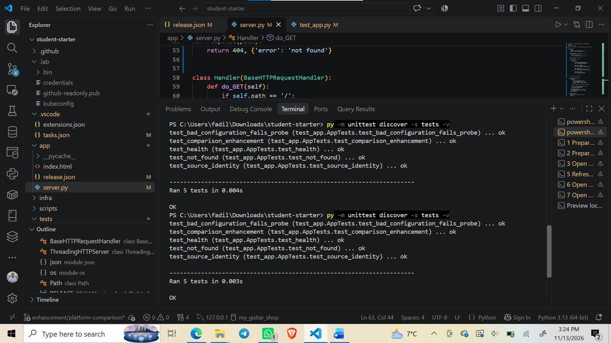
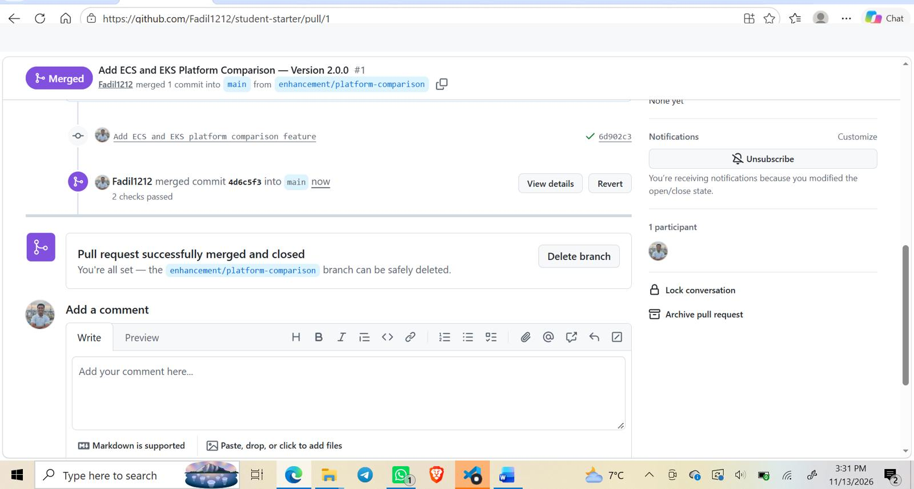
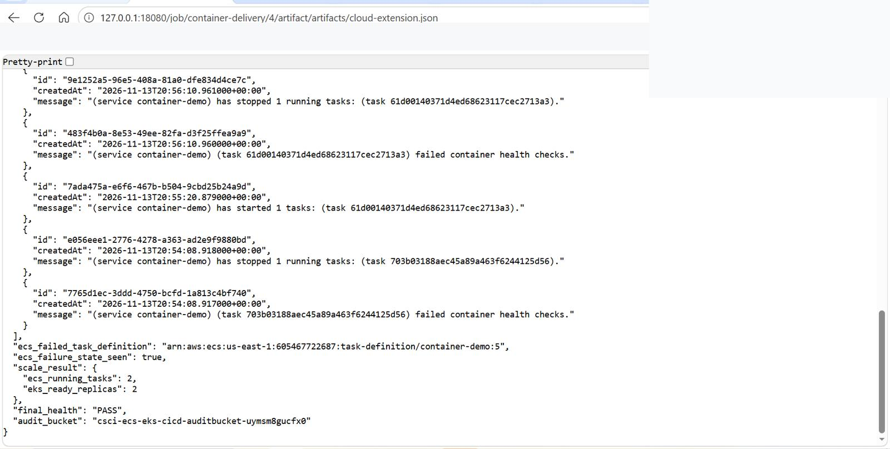
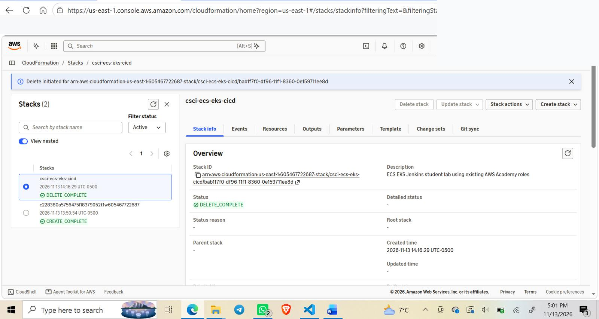

# Deployment evidence gallery

These screenshots were captured during the completed **November 13, 2026** AWS Academy workshop. The ECS/EKS environments were decommissioned after validation, so the URLs in the screenshots are local SSM tunnels, **not current public demos**.

## 1. Running the same release on two orchestrators

**Amazon ECS (Fargate)** — version 2.0.0, healthy, source commit prefix `4d6c5f38`.

**Amazon EKS (Kubernetes)** — same version and commit, healthy.

## 2. Version 2 enhancement and automated validation

**Comparison feature** — application definition, scheduling, recovery and scaling.

**Unit tests** — all five tests passed.

**Pull request merged** — feature branch review and CI checks.

## 3. Failure recovery and release verification

The extension JSON recorded failed ECS health checks, two ECS running tasks, two EKS ready replicas and final health `PASS`. Jenkins Build #4 completed successfully.

## 4. Responsible teardown

CloudFormation returned `DELETE_COMPLETE` for the workshop stack after resource cleanup.

## Related artifacts

- [Engineering case study](CASE_STUDY.md)
- [Full workshop Word report](ECS_EKS_CICD_Project_Report.docx)
- [Source code and run instructions](../README.md)

*Screenshots are provided to document actual observations. Account credentials and personal access tokens are intentionally not published.*
